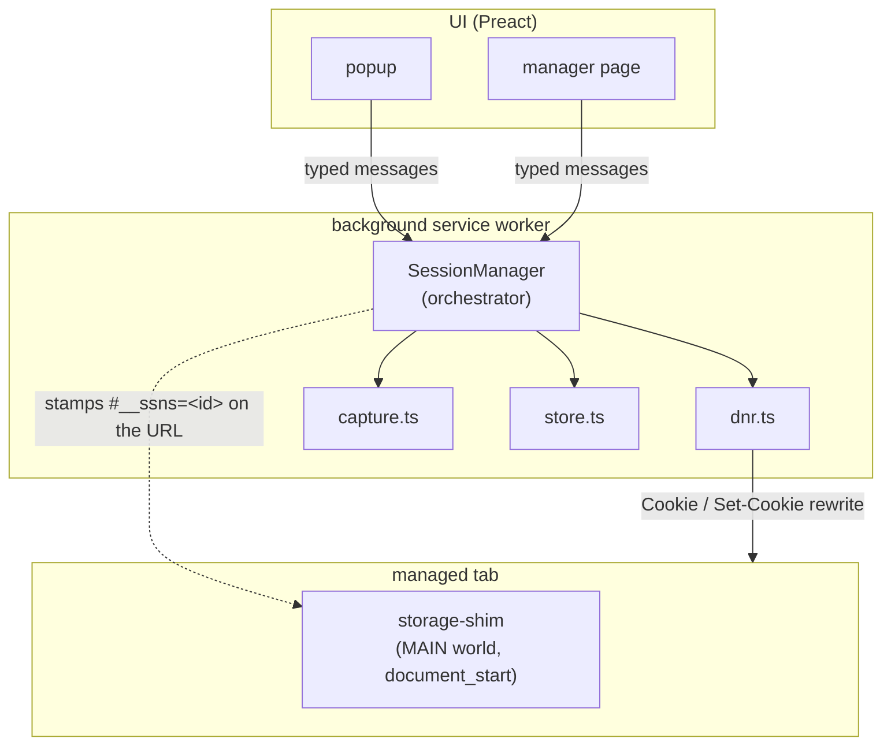
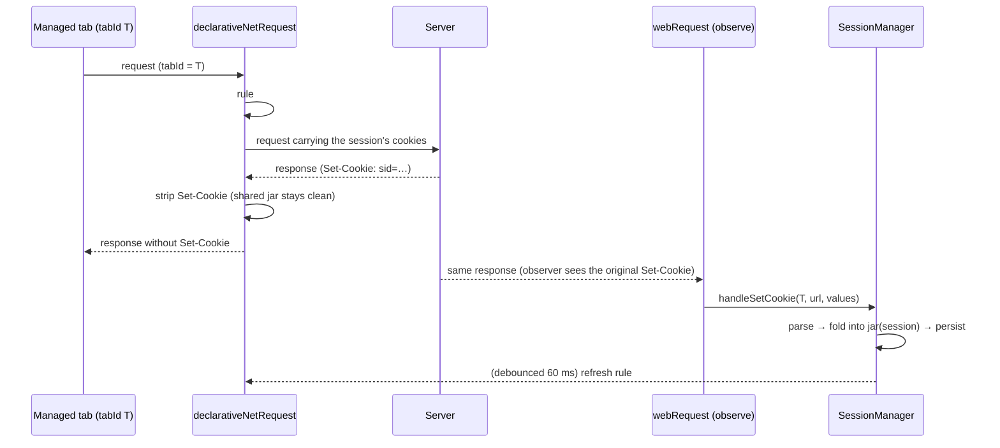
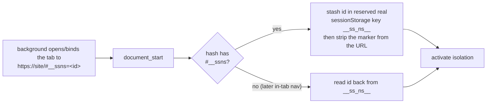

# Architecture — how Session Switcher isolates tab data

This document explains how the extension behaves at runtime and, specifically,
how it makes two tabs on the same site behave like two independent browsers.
It is the engineering companion to the user-facing [README](../README.md).

---

## TL;DR — the mental model

Chrome has **no per-tab cookie jar** (unlike Firefox's container tabs). Session
Switcher *synthesizes* one by combining three independent mechanisms, all
coordinated by a single background orchestrator (`SessionManager`):

| Layer | What it isolates | How | Code |
|------|------------------|-----|------|
| **Network** | HTTP cookies | `declarativeNetRequest` rewrites the outgoing `Cookie` header per tab and strips incoming `Set-Cookie`; `webRequest` observes `Set-Cookie` to keep each session's jar current | [`dnr.ts`](../lib/engine/dnr.ts), [`capture.ts`](../lib/engine/capture.ts), [`cookieJar.ts`](../lib/engine/cookieJar.ts) |
| **Page** | `localStorage`, `sessionStorage`, IndexedDB | a MAIN-world content script namespaces every storage key / DB name per session | [`storage-shim.content.ts`](../entrypoints/storage-shim.content.ts) |
| **Service worker** | the escape hatch | managed tabs disable service workers, whose requests carry no tab id and would bypass the network layer | [`storage-shim.content.ts`](../entrypoints/storage-shim.content.ts) |

Two definitions used throughout:

- A **session** is a named identity scoped to one *registrable domain* (e.g.
  "Work" on `example.com`). It owns an isolated cookie jar and storage namespace.
- A tab can be **bound** to a session. While bound, that tab's network traffic
  and web storage use the session's data instead of the browser's shared
  profile. Binding is ephemeral (per browser run); sessions are durable.

---

## The problem

A normal browser profile has exactly one cookie jar per origin. Open
`example.com` in two tabs and they share cookies — log into account B in one and
the other becomes account B too. Firefox solves this with *contextual
identities* (container tabs) that give each container its own cookie store keyed
by `cookieStoreId`. Chromium exposes no such primitive to extensions, so the
isolation has to be assembled from lower-level APIs.

The design keeps **all cookie state behind `SessionManager`**, so the storage
backend (today: header rewriting) could later be swapped for a true proxy
backend without touching the UI or the message protocol.

---

## Component map



- **`SessionManager`** ([`manager.ts`](../lib/engine/manager.ts)) is the single
  source of truth. It owns the in-memory caches — `bindings: Map<tabId, …>` and
  `jars: Map<sessionId, …>` — wires the capture listener, and exposes every
  high-level operation the UI calls.
- **Messaging** ([`messaging.ts`](../lib/messaging.ts)) is a typed request/response
  protocol (`MessageMap`) over `chrome.runtime`. The UI never touches the engine
  directly.
- **Persistence** ([`store.ts`](../lib/engine/store.ts)): sessions + jars live in
  `storage.local` (`unlimitedStorage`); tab→session bindings live in
  `storage.session` so they survive service-worker restarts but clear on browser
  restart — matching the lifetime of the session-scoped DNR rules.

---

## Layer 1 — per-tab cookie isolation (network)

### The rule

For each managed tab we install exactly **one `declarativeNetRequest` *session*
rule**, with `ruleId === tabId` (unique among live tabs). See
[`dnr.ts`](../lib/engine/dnr.ts):

```
condition: { tabIds: [tabId], requestDomains: [domain], resourceTypes: [main_frame, sub_frame, xmlhttprequest, script, image, stylesheet, font, media, ping, other] }
action:    MODIFY_HEADERS
  request:  set  "cookie"     = <session jar serialized for this domain>   (or REMOVE when the jar is empty ⇒ logged-out)
  response: remove "set-cookie"                                            (so the browser's shared jar is never written)
```

`tabIds` conditions are only valid on **session** rules — which conveniently
also survive SW restarts and auto-clear on browser restart.

### The capture → inject loop

The browser never persists these cookies. They live only in a session's jar, are
*injected* into requests by DNR, and are *captured* back out of `Set-Cookie`
response headers by an observe-only `webRequest` listener (the `extraHeaders`
opt-in is required for `Set-Cookie` to be visible). This is the read/write loop
that keeps each session independently logged in:



Implementation notes:

- **`handleSetCookie`** ([`manager.ts`](../lib/engine/manager.ts)) only folds a
  `Set-Cookie` into the jar when `registrableDomain(url) === binding.domain`, so
  third-party responses in the tab can't pollute the session.
- Updates are **debounced (60 ms)** into a single DNR refresh per session, so a
  burst of `Set-Cookie`s on login doesn't thrash the rules.
- The cookie store ([`cookieJar.ts`](../lib/engine/cookieJar.ts)) is a minimal,
  self-contained implementation: `parseSetCookie` (attributes, `Max-Age`/`Expires`,
  deletions, host-only vs domain), `toCookieHeader` (host/subdomain matching),
  `pruneExpired`, and `fillRecord` (insert-without-overwrite, used by import).
- Cookie keys are `name \0 domain \0 path`. The header is computed **coarsely**
  for the registrable domain and applied to it and its subdomains — identity
  isolation, not byte-exact cookie semantics, is the goal.

---

## Layer 2 — per-session web-storage isolation (page)

A **MAIN-world content script at `document_start`**
([`storage-shim.content.ts`](../entrypoints/storage-shim.content.ts)) runs before
any page script, on every frame. When the tab is managed it:

- wraps `localStorage` and `sessionStorage` in a `Proxy` that **key-prefixes**
  every entry with `__ss:<sessionId>:`. Reads, writes, `clear()`, `length`,
  `key(i)`, enumeration, and named property access (`localStorage.foo`) are all
  scoped, so concurrent sessions on one origin never see each other's keys —
  real isolation inside the single shared physical store, fully synchronous.
- replaces `indexedDB` with a wrapper that **prefixes database names** with
  `__ss_<sessionId>__`. Each session therefore gets *physically separate*
  databases with full native-engine fidelity (no re-implementation of the IDB
  API). `open` / `deleteDatabase` / `databases()` are mapped; `cmp` passes
  through.

It runs in the **MAIN world** (not the isolated content-script world) because it
must replace the *page's own* `window.localStorage` / `window.indexedDB`
references — the objects page scripts actually use. There is no `chrome.*` in the
MAIN world, so the shim depends only on the DOM and the shared string constants
in [`shimProtocol.ts`](../lib/shimProtocol.ts). It **fails safe**: any error, or
an unmanaged tab, leaves native storage untouched.

### Delivering the session id synchronously (the key trick)

The shim needs the session id *at `document_start`*, before page scripts run —
too early for async messaging. So the id is delivered through the URL:



The marker is read once on first load and persisted in a reserved
`sessionStorage` key (`__ss_ns__`) so it survives in-tab navigations within the
origin; the visible URL is cleaned up with `history.replaceState`. Constants:
`NS_HASH_PARAM = "__ssns"`, `NS_SESSION_KEY = "__ss_ns__"`.

---

## Layer 2.5 — service-worker neutralization

This is the subtle one, and the cause of a real isolation failure on heavy SPAs.

A site's **service worker is per-origin**, not per-tab — one instance serves
every tab of that origin — and the network requests it issues carry **no tab id
(`tabId === -1`)**. The Layer-1 DNR rule conditions on `tabIds`, so it can never
match SW-originated traffic. Result: once a SW takes control of a managed tab
(typically after the first reload), the app's authenticated requests are
re-issued by the SW, bypass the per-tab rule, and fall through to the **shared**
profile — collapsing every session onto one identity.

Because a single shared worker fundamentally cannot be scoped per session, the
shim **disables service workers in managed tabs** (`disableServiceWorkers`):

- blocks `navigator.serviceWorker.register` (returns a rejected promise);
- unregisters any worker left over from a prior *unmanaged* visit;
- if a worker was already controlling this load, reloads **once** (guarded by a
  reserved `__ss_sw_reloaded__` key to prevent loops) so the page re-runs
  worker-free and all traffic returns to the tab-scoped path.

**Trade-off:** managed tabs lose that site's offline cache and web push.
Unmanaged tabs are untouched (they keep their service worker). This is exercised
by [`test/e2e-sw.mjs`](../test/e2e-sw.mjs), including the "worker already active
for the origin" case.

---

## Lifecycle operations

| Operation | What happens | Notes |
|-----------|--------------|-------|
| **Open** (`openInSession`) | create an `about:blank` tab → **bind** (installs the DNR rule) → navigate to `https://domain/#__ssns=<id>` | blank-first so the rule is in place *before* the real navigation races it |
| **Use here** (`bindTab`) | append the marker to the current URL → bind → update the tab; if the change is **hash-only** (same-document), force a reload | the reload guard ([`sameDocument`](../lib/engine/manager.ts)) ensures the `document_start` shim actually re-runs |
| **Adopt browser login** (`importCurrentLogin`) | copy the shared profile's real cookies for the domain into the session jar, **filling only missing cookies** | `fillRecord` never overwrites a session's own login (that would merge identities); the popup offers it only while the session is logged out |
| **Detach** (`unbindTab`) | drop the binding + DNR rule, clear the reserved `__ss_ns__` key via `chrome.scripting`, reload back into the shared profile | |
| **Capture** (background) | `Set-Cookie` → jar → debounced rule refresh | the loop above; keeps sessions logged in |
| **Delete** (`deleteSession`) | detach any bound tabs, drop the session record + jar | |

Binding state is also reconciled on `tabs.onRemoved` and on every SW startup
(`init()` re-asserts DNR rules for persisted bindings).

---

## What is and isn't isolated

| Data channel | Isolated? | Mechanism / reason |
|---|---|---|
| HTTP cookies (`Cookie` / `Set-Cookie`) | ✅ per tab | DNR rewrite + `webRequest` capture |
| `localStorage` / `sessionStorage` | ✅ per session | key prefix `__ss:<id>:` |
| IndexedDB | ✅ per session | DB-name prefix `__ss_<id>__` |
| Service workers | ✅ neutralized in managed tabs | registration blocked + existing unregistered |
| `document.cookie` (JS-set cookies) | ⚠️ **shared** | not intercepted — reads/writes hit the real per-origin jar. Server-side auth (httpOnly cookies) is unaffected since those flow through the DNR-controlled header; but non-httpOnly cookies are visible across sessions |
| Cache Storage (`caches`) | ⚠️ shared | per-origin; not namespaced (mostly mooted by disabling SWs) |
| Cross-origin SSO (a *separate* identity provider, e.g. a federated Google/Microsoft login) | ⚠️ not isolated | only the site's own registrable domain is rewritten |
| HTTP auth, TLS client certs, `Authorization` tokens in JS memory | ❌ out of scope | not a cookie/storage channel |

**Path-scoped cookies** are sent coarsely (the whole domain jar per request) and
all sessions on one origin **share that origin's `localStorage` quota** (keys are
prefixed within one physical store, not given separate quotas).

---

## Guarantees and boundaries

- **The shared profile stays clean.** Because DNR strips `Set-Cookie` for managed
  tabs, logging into a session never writes cookies into the browser's real jar.
  An unmanaged tab on the same site sees no session login. (Asserted in
  [`test/e2e.mjs`](../test/e2e.mjs).)
- **Sessions don't see each other.** Distinct per-tab DNR rules + per-session
  storage prefixes mean two concurrently-open sessions resolve to different
  identities at the server and never read each other's storage.
- **Not a security sandbox.** This is identity *separation* for convenience, not
  a defense against a malicious page. A page that wants to can still read its own
  `document.cookie`, fingerprint the device, or exfiltrate via channels the shim
  doesn't cover. Treat sessions as "different accounts," not "different security
  principals."
- **Chromium only.** The whole network layer depends on Chromium MV3
  `declarativeNetRequest` session rules with `tabIds`; Firefox lacks these (it
  has native containers instead).

---

## File map

```
lib/types.ts                          core data model (Session, CookieJar, TabBinding, TabContext, BackupFile)
lib/domains.ts                        registrable-domain (eTLD+1) resolution + known-site names
lib/shimProtocol.ts                   MAIN-world-safe constants: NS_HASH_PARAM, NS_SESSION_KEY, prefixes, withNamespaceMarker
lib/messaging.ts                      typed UI ↔ background protocol (MessageMap)
lib/engine/cookieJar.ts               parse/serialize/match cookies; fillRecord; pruneExpired
lib/engine/store.ts                   chrome.storage wrappers (sessions/jars in local, bindings in session)
lib/engine/dnr.ts                     per-tab declarativeNetRequest session-rule management
lib/engine/capture.ts                 webRequest.onHeadersReceived Set-Cookie observer
lib/engine/manager.ts                 SessionManager — the orchestrator
entrypoints/background.ts             instantiates the manager, registers message handlers
entrypoints/storage-shim.content.ts   MAIN-world storage namespacing + SW neutralization
entrypoints/popup/                    per-site popup UI
entrypoints/manager/                  full-page session manager (export/import)
```

---

## Testing the isolation

The mechanics above are pinned by tests, so regressions surface fast:

- **Unit / integration** (`npm test`, Vitest) — cookie parsing, domain
  resolution, the namespace protocol, and the `SessionManager` driven against a
  faked `chrome` API, including a proof that two concurrent sessions stay
  separate and that import never overwrites a session's own login.
- **End-to-end in real Chrome** (`npm run test:e2e`) — loads the built extension
  and drives a local fake-login server (no real accounts): concurrent isolated
  logins, a clean shared profile, per-session storage namespacing
  ([`e2e.mjs`](../test/e2e.mjs)), and the service-worker regression
  ([`e2e-sw.mjs`](../test/e2e-sw.mjs)).

See [`HANDOFF.md`](../HANDOFF.md) for the full testing notes and project status.
